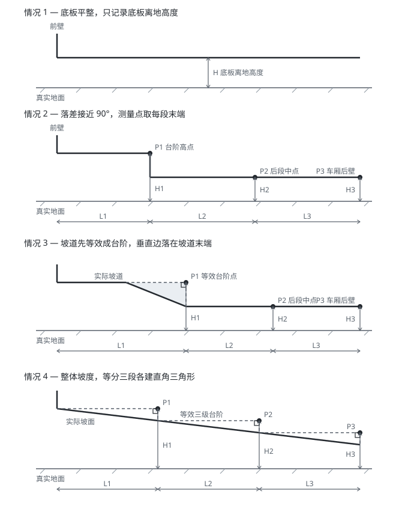

# 车厢底板剖面测量规格

## 1. 背景与用途

部分货车车厢底板不是一个平面：半挂车常有鹅颈段抬高，也有整体带排水坡度的车型。
本功能把底板沿车长方向抽象成一条**阶梯折线**，用 3 组「高度 H + 长度 L」描述，
供下游系统建立**车辆档案**。

> 用途限定为车辆档案，不参与煤量体积计算。因此等效方式按几何直观取值，
> 不要求保体积（详见 3.3 的约定后果）。

## 2. 适用前提

| 前提 | 说明 |
|---|---|
| 仅空车可测 | 载货时俯视雷达看到的是货面而非底板。实测：空车底板以上点占内部点 7.8%，载货 99.2% |
| 需要固定地磅标定面 | 所有 H 以地磅台面为基准；地磅与真实地面有高度差，二者不可替代 |
| 随基准存档 | 剖面在空车建基准时测量，写入该车牌的 `baseline.json`；载货车复用历史剖面，不现场重测 |

## 3. 通用约定

### 3.1 高度基准

H = 测量点到**固定地磅台面标定面**的法向距离。

2026-11-06 经用户与甲方确认，业务字段 `trailerBottomToGroundHeight` 取
**车厢前内壁处的底板离磅台高度**（剖面 s=0），不再取全车厢最低高度。
沿用既有 s=0 剖面读数规则；前部存在观测缺口时取最靠前的有效分箱，
不另加缺测门禁，也不沿坡线外推一个未观测高度。没有有效剖面时为 null。
这一字段与下述三段 H/L、`highLowPlateHeight`、最高/最低板明细分别计算；
三段坐标、高差和车厢内高的口径不变。

不能用局部坐标的 z 差代替：局部 H 轴来自车体自身的 PCA/平面拟合，与地磅面法向不一定平行。
实测倾角 1.05° 时，在 11.3m 车长上会累积约 0.2m 偏差，做档案不可忽略。

### 3.2 长度基准

L = 沿车厢纵轴（车长方向）的**水平投影距离**。

- `L1` 从**车厢前壁**起算
- `L2`、`L3` 从**前一个测量点**起算

### 3.3 测量点规则（四种情况统一）

> **测量点的 L 取该段（或该落差特征）的后边界，H 取其前边界处的高度。**

这条规则来自「垂直边放在车厢里面」的约定，一条式子覆盖情况 2/3/4：

| 情况 | 特征 | 点的 L | 点的 H |
|---|---|---|---|
| 2 | 垂直台阶 | 台阶位置 | 抬高面高度（台阶前后同位置） |
| 3 | 坡道 | 坡道末端 | 坡顶平台高度 |
| 4 | 第 i 段 | 该段后边界 | 该段前边界处高度 |

**约定后果**：测量点落在**等效阶梯面**上，不在实际底板面上。情况 3 的 P1 位于坡道末端的
横坐标、但取坡顶平台的高度；情况 4 每个顶点同理。等效阶梯永远包在实际底板之上（下坡时），
坡面之上的三角形计入抬高段。

### 3.4 分段规则

- 第 1 段由**台阶/坡道的实际位置**决定，不是固定 1/3
- 剩余部分（第 1 段末端 → 车厢后壁）**平均分成 2 段**，分界点即 P2
- P3 固定取车厢后壁

---

## 4. 四种情况



### 4.1 情况 1 — 底板平整

不分段，只输出单个 H（底板离地高度）。

### 4.2 情况 2 — 落差接近 90°

| 段 | 测量点 | H | L |
|---|---|---|---|
| 1 | 台阶高点 | 抬高面离地高度 | 前壁 → 台阶 |
| 2 | 后段中点 | 该处离地高度 | 台阶 → P2 |
| 3 | 车厢后壁 | 该处离地高度 | P2 → P3 |

第 2、3 段长度由「平均分成 2 段」的定义决定，因此 `L2 == L3`。这是预期行为，
输出仍保留两项以保证格式统一。

### 4.3 情况 3 — 落差为坡道

与情况 2 只差在第 1 段的等效方式：

- 坡道以直角三角形等效成台阶，**垂直边落在坡道末端**（靠车厢里侧）
- 坡面之上的三角形（图中阴影）**计入抬高段**
- 因此 `L1` 包含坡道的水平投影，一直量到坡道与下层底板的交点
- `H1` 取**坡顶平台**的高度，不是坡道末端的实际高度

后两段从坡道末端开始平均分成 2 份，量法与情况 2 完全一致。

### 4.4 情况 4 — 整个底板是坡度

- 按**长度**等分 3 段（不是等高差）
- 每段以坡面为斜边构建直角三角形：水平边取该段**前边界**的高度向后延伸，
  垂直边落在该段**后边界**
- 三个 90° 顶点即 P1/P2/P3，整体形成包住坡面的三级递降阶梯

| 段 | 点的 L | 点的 H | L 值 |
|---|---|---|---|
| 1 | 第 1 段后边界 | 前壁处高度 | 前壁 → P1 |
| 2 | 第 2 段后边界 | 第 1 段后边界处高度 | P1 → P2 |
| 3 | 第 3 段后边界（后壁） | 第 2 段后边界处高度 | P2 → P3 |

---

## 5. 判别流程

```
底板剖面（沿车长每 bin 取底板面高度）
        │
        ├─ 全长高度极差 < flat_tolerance ────────────────► 情况 1
        │
        ├─ 落差集中在单一窄区间，且区间前后各自近水平
        │        │
        │        ├─ 落差段倾角 ≥ step_angle_min ────────► 情况 2
        │        └─ 落差段倾角 <  step_angle_min ────────► 情况 3
        │
        └─ 全长单调倾斜、无明显平台 ─────────────────────► 情况 4
```

判别指标建议：

| 指标 | 用途 | 建议值 |
|---|---|---|
| `flat_tolerance` | 全长极差小于此值判平整 | 0.05 m |
| `step_angle_min` | 台阶 / 坡道分界角 | 75° |
| `step_span_max_ratio` | 落差区间占车厢长的比例上限（超过则视为整体坡度） | 0.25 |
| `step_drop_min_ratio` | 落差区间内的高度变化占总极差的比例下限 | 0.70 |
| `plateau_flat_tolerance` | 落差前后各自「近水平」的容差 | 0.08 m |

阈值需按现场实车标定，当前值为推断值。

---

## 6. 输出结构

写入结果 JSON，同时随空车基准存入 `baseline.json`：

```json
"floorProfile": {
  "case": 2,
  "caseName": "step_90",
  "heightReference": {
    "type": "weighbridge",
    "source": "weighbridge_calibration",
    "frame": "source"
  },
  "referencePlane": [0.0165, 0.0080, 0.9998, -1.2340],
  "stepAngleDeg": 87.4,
  "segments": [
    { "index": 1, "pointType": "step_top",  "heightToReference": 1.420, "lengthToPrev": 3.200 },
    { "index": 2, "pointType": "mid_rear",  "heightToReference": 0.950, "lengthToPrev": 4.050 },
    { "index": 3, "pointType": "rear_wall", "heightToReference": 0.950, "lengthToPrev": 4.050 }
  ],
  "confidence": "high",
  "warnings": []
}
```

字段说明：

| 字段 | 含义 |
|---|---|
| `case` | 1 / 2 / 3 / 4，对应本文四种情况 |
| `caseName` | `flat` / `step_90` / `step_ramp` / `full_slope` |
| `referencePlane` | 源坐标系中的参考面系数 `[a,b,c,d]` |
| `heightReference.type` | 生产为 `weighbridge`；兼容入口可能为 `scene_ground` / `relative_floor` |
| `heightReference.frame` | `source`（与输入 PCD 同系）/ `local`（仅直接调用分析器时出现） |
| `heightReference.source` | 生产链必须为 `weighbridge_calibration` |
| `stepAngleDeg` | 落差段倾角，仅情况 2/3 有值 |
| `segments[].pointType` | `step_top` / `ramp_end` / `mid_rear` / `rear_wall` / `slope_vertex` |
| `segments[].heightToReference` | H，米；结合 `heightReference.type` 解释物理基准 |
| `segments[].lengthToPrev` | L，米。第 1 段即「到车厢前壁的距离」 |
| `confidence` | 沿用车厢剖面的质量评级，远端稀疏时降级 |

情况 1 时 `segments` 只有一项（`pointType: "flat"`，`lengthToPrev` 为车厢长）。

---

## 7. 实现要点

### 7.1 地磅台面必须离线标定

场景里可能同时存在真实地面和高出地面的地磅台面。按单帧点数或“最低水平面”
动态选择，能够得到稳定的平面，却无法保证它就是业务要求的地磅面。

生产双雷达链把 CAM_004 坐标系中的固定台面写入外参 JSON 的
`weighbridgePlaneA`。该平面既用于把任意源 XYZ 临时统一为 Z-up，也作为所有 H
的零点。缺少标定面时仍可做空载判断，但 `floorProfile` 必须为 `null`，不得用
真实地面或最低底板代替后继续上传。

### 7.2 地磅平面要变换到局部坐标

底板剖面沿局部 L 轴提取，地磅平面在源坐标系。设局部坐标 `p_local = Rᵀ(p − origin)`，
则平面 `nᵀp + d = 0` 在局部坐标下为：

```
n_local = Rᵀ n
d_local = nᵀ·origin + d
```

`R` 正交，点到平面的有符号距离在两个坐标系下相同。

### 7.3 坡向反转

现场这批车是前段抬高（鹅颈）。若遇到后高前低的车型，3.3 的统一规则
（L 取后边界、H 取前边界高度）**方向无关，公式不变**：

- 下坡（前高）：等效阶梯在实际底板**之上**
- 上坡（前低）：等效阶梯在实际底板**之下**

两种情况下垂直边都落在段的后边界，符合「垂直边放在车厢里面」。

---

## 8. 验证状态

| 情况 | 真车数据 | 状态 |
|---|---|---|
| 1 平整 | 有（`CAM_004_..._d389e15e` 空车，底板面 z≈−0.49，全长无落差） | 可验证 |
| 2 90° 台阶 | 无 | 仅合成数据自测 |
| 3 坡道台阶 | 无 | 仅合成数据自测 |
| 4 整体坡度 | 有（`1256_258460_20260910_164433` 空车，全长 11.85m 降 0.118m ≈ 10 mm/m） | 真车回归，H/L 绝对值仍未验证 |

**情况 4 的真车数据**（2026-09-10 16:44，雷达 1256，用户确认空车）：底板前 4m 近水平、
后 7.85m 下降，落差区间宽 7.9m。该车同时由雷达 1260 独立复核，两台各自拟合地面后测得
的坡向一致（车头高、车尾低），车旁地面本身平整到 ±3 mm/m，故坡度来自车辆而非路面。
实测剖面已固化为 `tests/unit/test_floor_profile_real_slope.py` 的回归用例，覆盖两个合成
数据没有的特征：坡度只有合成用例的 1/5（10 vs 50 mm/m），以及"前平后斜"的非匀坡形态。

**验证缺口**：情况 2/3 仍无真车数据。情况 4 已有真车但**缺卷尺实测高差**，因此回归用例
只能断言与实测剖面自洽，不能断言 H1/L1 与车辆真值一致 —— 绝对准确性仍未验证。

**已知的阈值敏感性**（基于上述真车数据实测）：

| 改动 | 结果 |
|---|---|
| `flat_tolerance` 0.05 → 0.12 | 判成情况 1，三段数据消失 |
| `step_span_max_ratio` 0.25 → 0.70 | 判成情况 3，P2 的 H 相差 9.3cm |

本车全长落差 0.118m 对 `flat_tolerance` 只有 2.4 倍余量；放宽该容差会直接吞掉缓坡车型。

## 9. 已确认事项

- 上坡车型（后高前低）按 7.3 处理：统一规则方向无关，公式不变
- 阈值按第 5 节表格取值实现；后续按现场实车再标定
